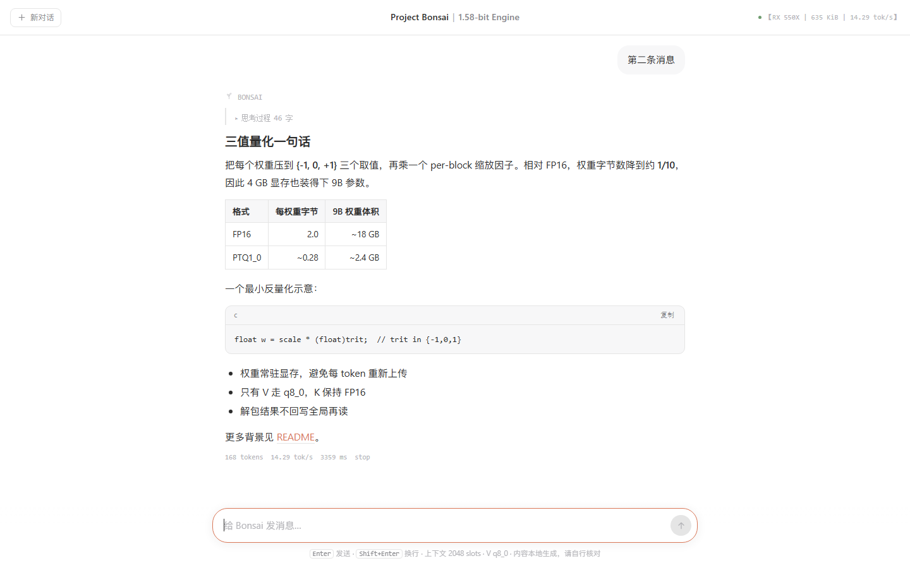

> **Fidelity first.** Every path in this runtime — tokenizer, attention, KV layout, dequantisation — was
> built by diffing against the reference implementation, layer by layer, and is guarded by a gate that
> refuses to generate if a single bit differs. Speed that changes the numbers is not shipped here.

# Project Bonsai

**A 464 KiB hand-written C++17 + raw-Vulkan inference engine, built for 1.58-bit ternary models only.**
No framework, no kernel library, no SDK, no administrator rights, no dependency you can name. It runs a
9B ternary checkpoint on a **4 GB AMD RX 550X** — a laptop GPU from 2017 that costs less than a meal —
at **14.16 tok/s** (pure CLI engine rate, measured in `runs/regression_v14.log`), which is **3.21× the reference engine** for
the same checkpoint on the same card.

```
$ cd runtime_vk && set BONSAI_QCHECK=1
$ bonsai_vk.exe run models/Ternary-Bonsai-2-9B-PTQ1_0.gguf 32 48
  rotation route: block_size = 4096 -> hat4096.comp (bit-frozen, the 9B's path), normalize = 0.015625
  prefill 1154.5 ms for 16 prompt tokens (13.86 tok/s)
=== QK kernel audit (BONSAI_QCHECK, 16 live keys in the row, cap 256, dispatching NARROW q2048) ===
  A  layer 0 (cap<=256): SCORE 0/4096 bit-diff, PROB 0, P16 0  -> bitwise identical
  A3 layer 0 (cap 256, ref NARROW, HPK 4, merged q512, grid 16 -> 4): SCORE 0/4096 bit-diff -> identical
  A4 layer 7 (cap 256, PV q8_0 frozen vs merged, grid 16 -> 4): PGATE 0/4096 bit-diff -> identical
  gate: PASS (bitmask 0 = A ok A2 ok A3 ok A4 ok B ok C ok D ok E ok)
  48 generated tokens in 3389.5 ms  ->  14.16 tok/s
  first generated token (prefill+1): 70.2 ms; steady-state: 70.6 ms/token
```

## Quick Start — the WebUI

Double-click `bonsai_vk.exe` (or run `bonsai_vk.exe serve`). The engine loads the weights, starts a
loopback-only HTTP server on port **8080**, and opens your default browser at `http://localhost:8080`.
No install, no Node, no build step — the whole front end is one self-contained `index.html` shipped next
to the exe.



- **Chat**: type in the bottom box; `Enter` sends, `Shift+Enter` adds a newline. Replies stream in over
  SSE with a typewriter caret and render Markdown (headings, tables, code, lists). The top-right badge
  reports the *measured* device, engine size and decode rate, not a hardcoded slogan.
- **Thinking**: the model's reasoning phase is collapsed under "思考过程" and the visible answer follows.
  Set `BONSAI_THINKING=0` to stream the answer directly.
- **OpenAI-compatible API**: `POST /v1/chat/completions` with `stream:true` (SSE) or `false` (unary),
  plus `GET /v1/models`, `GET /v1/status`, `GET /health`. One conversation at a time; a second concurrent
  request gets `429`. The server binds loopback only and rejects non-loopback `Host` headers.

```
curl http://localhost:8080/v1/chat/completions -H "Content-Type: application/json" ^
  -d "{\"model\":\"bonsai\",\"stream\":true,\"messages\":[{\"role\":\"user\",\"content\":\"你好\"}]}"
```

The CLI path is unchanged: `bonsai_vk.exe run <gguf> 32 48` still prints the same gate and rate as above.
The HTTP shell adds no per-token GPU work — it only serialises the tokens the forward pass already emits.

**Linux**: the same sources compile on Linux via `runtime_vk/build_linux.sh` (POSIX sockets + amdgpu
sysfs VRAM monitor instead of Winsock + PDH/DXGI). **Linux 编译支持已就绪，待实机验证** — the `#ifdef`
branches are written and the Windows build is warning-free, but no Linux machine was available to run it.

## What "1.58-bit only" buys

| | |
|---|---|
| **The format is the algorithm.** | PTQ1_0 packs **5 trits per byte** and shares one **fp16 scale per 128 weights**. The dequant path is 5 `bitfieldExtract`s and a table of ±1/0 signs — it fits in registers, so it is inlined into the GEMV instead of being a pass over memory. Measured `max\|err\| = 0.00000` against the official dequant kernel *running on this card*, and bitwise identical over 491 520 synthetic weights including zero, subnormal, negative-scale and non-finite scales. |
| **Nothing is generalised.** | There is no model-agnostic graph, no op registry, no tensor library. The engine is the shape of this checkpoint family: 32 blocks, 24 gated-recurrent layers and 8 softmax-attention layers, hidden 4096, FFN 12288, vocab 248 320, `head_dim = 256`. |
| **The Hadamard rotation is honoured, not approximated.** | The checkpoint ships `prism.hadamard.*` metadata that states its own transform contract (`normalized-sylvester-walsh-hadamard`, block 4096, signs at widths 4096 and 12288, 201 rotated weight tensors, `token_embd.weight` stored in the *inverse* basis). The engine reads those keys and applies exactly the sequence the reference graph orders. Ignore them and the output is garbage; this is the first thing a ternary port gets wrong. |
| **Every performance claim is a log line.** | [`BENCHMARK.md`](BENCHMARK.md) carries the measurements. [`KV_P0P1P2_MEASURED.md`](KV_P0P1P2_MEASURED.md) carries the long-context work, including the two premises we measured, found false, and corrected in public. |

## What it does on 4 GB of e-waste

| Measured on this card | |
|---|---|
| Decode rate — **pure CLI ceiling** (engine rate, no HTTP) | **14.16–14.29 tok/s** (70.0–70.7 ms/token), 48-token runs: `runs/regression_v14.log`, `runs/webui_regression_v3.log`, `runs/webui_attrib_v2.log` leg A = 14.22 |
| Decode rate — **HTTP Serve, engine self-report** (`/v1/status.last_tok_s`, excludes prefill + network) | **14.03–14.23 tok/s**: `runs/webui_ab_v1_summary.txt` = 14.03, `runs/webui_attrib_v2.log` leg C = 14.23 |
| End-to-end — **client wall clock** (includes prefill + loopback HTTP) | **≈ 9.1–9.8 tok/s**, `runs/webui_attrib_v2.log` leg C client = 9.49 — the experience number, **not** the engine decode rate |
| Reference engine, same checkpoint and card | 4.417 t/s ⇒ **3.16×** at the 13.99 tok/s first ignition, **3.21×** at today's 14.16 |
| Ternary GEMV, `M=12288 K=4096` | **176.9 Gop/s**, 44.2 GB/s of packed weights (band 173.6–177.0 Gop/s over 12 consecutive build self-tests, `runs/build_v31.log` … `build_v42.log`) |
| Weighted kernel mix over the model | **147.3 Gop/s** |
| Weight load | **14.05–14.44 s cold** (four independent first-reads), **1.05–1.20 s warm**; page-cache state is not controlled by the harness, so both regimes are quoted |
| Device-local footprint | weights committed **2467.7 MiB** (2.410 GiB), activations **58.2 MiB** at cap 256 / **101.339 MiB** at 2048 / **841.261 MiB** at 32 K (all printed by the engine itself; the 256-slot one is `52.0 MiB cap-independent + 256 × 24.66 KiB`); PDH dedicated **2539.23 MiB** at cap 256 — i.e. 2467.7 + 58.2 + 13.3 the driver charges and the budget table does not model — and **3323.84 MiB** at 32 K, with `Shared Usage` growth **+0.00** at both |
| Long context, paired ladder, merged QK on (default) | 4 K **9.41**, 8 K **6.93**, 16 K **4.57**, 32 K **2.67 tok/s** (`runs/gqa_pair_v1_summary.txt`; the same-binary control with the merge off is 7.88 / 5.34 / 3.29 / 1.84) |
| KV cost | 24.50 KiB/token over 8 attention layers (q8_0 V, fp16 K). The arena math puts the 4 GB ceiling at ≈ 39.2 K tokens — see the note under this table on why that is not the same number as the reference engine's `-c 49152` wall |
| gfx803 has no DP4A and no matrix cores, `shaderFloat16 = 0` | so every MAC is scalar fp32 over an inline-dequantised ternary operand, and fp16 is emulated with `f16_rne.glslh` |

The three rate rows are **different measurements and are never averaged together**. The CLI ceiling and
the serve engine self-report both count generated tokens over the forward-pass wall time (prefill and
network excluded), so they agree at ≈ 14.2 tok/s; the client wall clock additionally pays for prefill and
the loopback round-trip, so it lands near 9.5. [`PROJECT_BONSAI_WEBUI_REPORT.md`](PROJECT_BONSAI_WEBUI_REPORT.md)
§4 carries the same split. Quoting one as if it were another is the error this table exists to prevent.

Two "4 GB wall" numbers circulate in this repo and they are **not** the same measurement, so they are
listed apart on purpose: `−c 49152` passing and `53248` failing is the *reference llama.cpp fork*'s
budget on this checkpoint (`END_TO_END_MEASURED.md`, measured), while ≈ 39.2 K tokens is *our* arena's
arithmetic ceiling (DERIVED from the engine's own printed constants — weights 2467.7 MiB committed,
52.0 MiB cap-independent, 24.66 KiB/slot, DXGI LOCAL budget 3464.6 MiB, so
`(3464.6 − 2467.7 − 52.0) × 1024 ÷ 24.66 = 39 237` slots; against the raw 3840 MiB device-local heap it
would be 54 825, and the engine prints that headroom itself at cap 256 as
`headroom 1314.1 MiB (= 54558 more slots)`, `runs/gqa_gate_c256_v1.log:49`, `KV_P0P1P2_MEASURED.md`).
Neither has been driven past 32 K in a live run.

The engine is **464 KiB of source with comments stripped** — 765 KiB as written, because the comments
record *why* and not *what*; 313 KiB if whitespace is also removed; 400 KiB of that is the C++ host and
64 KiB is the GLSL — building to a **635.7 KiB binary** (650 996 B) plus **52 SPIR-V modules (300 KiB)**.
Every one of those figures comes from `python tools/source_size.py`, which is the only producer of them.
The pre-WebUI engine was 416 KiB de-commented / 539 KiB binary; the HTTP server, the cross-platform
`bonsai_platform.h` abstraction and the WebUI serving path account for the growth. Link flags on Windows:
`-lvulkan-1 -lpdh -ldxgi -lws2_32 -lshell32`, all supplied by the operating system (Linux needs only
`-lvulkan -lpthread`). The measurement drivers (`align_*.cpp`, `bonsai_fleet.cpp`, `gpu_fleet.h`) are
another 310 KiB de-commented and are not needed to run a model.

## Scaling to 27B: two paths that do not require buying a card

A 5.9 GB ternary 27B does not fit in 4 GB, and it never will — so the two mechanisms are about never
needing to. Both are **built and measured on this host**; neither is a plan.

**Pipeline parallelism over a card array (`bonsai_fleet split <layers> <cards> [budget_MiB] --model PATH`).**
Layer ranges are assigned per device (three strategies with an honest reason string each: layer, KV-weighted balance,
equal-share; the first two refuse below two devices), and the hidden state crosses cards through a
**pinned ring buffer** with async DMA on the **transfer-only queue family**, so card *k+1*'s block
overlaps card *k*'s copy. What has actually been measured here (`runs/fleet_ring_v4.log`,
`bonsai_fleet.exe ring 4 8 6` = depth 4, 8 MiB slots, 6 hops):

| | |
|---|---|
| Ring correctness | D2H arrival **0 byte mismatches** over 12 words read / 4 written slots, cursor cross-check `produced 6 vs hops 6 -> consistent` |
| One 8 MiB D2H leg, transfer-only family | **1204.6 µs = 6.96 GB/s = 97 % of the MEASURED 7.15 GB/s ceiling**, submit + fence + queue-drain included |
| Eight 8 MiB legs in ONE submit | **1176.4 µs per copy = 7.13 GB/s** end-to-end — the batching the engine can do when the sync is amortised |
| Back-pressure | **2 events at depth 4**; a depth-1 ring takes one host wait per hop, so depth is the mechanism and not a tuning knob |
| Per hop (this host: one card standing in for two) | wall **3171.3 µs**, D2H fence 2706.7 µs, doorbell 0.3 µs, CB-recycle 17.8 µs over 8 waits |
| Multi-card topology on THIS machine | `probe` reports **1 COMPUTE-capable device of 1 physical device visible to the loader**, so (A) layer-pipelined multi-GPU is **NOT AVAILABLE / NOT EXERCISABLE HERE**: the schedule, the ring and the fences are compiled and tested on the paths this host can reach, and no PCIe-to-PCIe hop has been taken here |

That last row is the honest boundary: the ring, the DMA legs, the back-pressure, the doorbell and the
bandwidth are measured; the second card's compute stream and the card-to-card path are not, because
this laptop has one usable GPU. The numbers that make the design worth building anyway are older and
independent: SDMA runs at **7.12 GB/s and does not discount concurrent compute**, and the per-token
host bubble on a single card is **16.8 ms** (11.8 fence + 5.0 submit) — measured in
`DEEPINFER_EVAL.md` and `END_TO_END_MEASURED.md`. Machinery:
[`runtime_vk/gpu_fleet.h`](runtime_vk/gpu_fleet.h); tool:
[`bonsai_fleet.exe`](runtime_vk/bonsai_fleet.cpp) `selftest | probe | split | ring`.

**Zero-copy on an iGPU.** When the selected device reports `VK_PHYSICAL_DEVICE_TYPE_INTEGRATED_GPU`, the
weight arena is allocated from a heap that is `HOST_VISIBLE | DEVICE_LOCAL` **at the same time**, the
staging buffer and the per-upload H2D copy disappear, and the CPU writes weights once into memory the
GPU is already reading. No WDDM budget, no spill, no 4 GB wall — an iGPU has no dedicated pool to run
out of. `bonsai_fleet.exe probe` on this machine reports the *capability* as **AVAILABLE**: memory types
2 and 6 are `DEVICE_LOCAL | HOST_VISIBLE | HOST_COHERENT` at once — but on this discrete card that heap
is a **256 MiB BAR window**, not a place to put a 2.34 GiB weight arena, which is exactly why the
zero-copy branch is gated on `deviceType == VK_PHYSICAL_DEVICE_TYPE_INTEGRATED_GPU` and never taken
here. The discrete path is untouched when the branch is not taken, so all existing measurements still
stand.

**27B layer mix, gated rather than assumed.** 64 blocks = **16 full attention + 48 recurrent**, and a
recurrent block gets **no KV cache slot** — that is a structural invariant, not a convention, and
`align_27b.exe` proves it: 49.000 KiB/token across the 16 charged layers, 1568.00 MiB arena at cap 32 768,
100.50 MiB of recurrent state, and the forbidden "KV on every block" allocator priced at 196.000
KiB/token = **4.0×** (4704 MiB at cap 32 768). The same tool gates the rotation contract
(`prism.hadamard.version` decides whether a rotation happens at all; `block_size` routes between the
9B's bit-frozen `hat4096.comp` and the generic `hadamard_fwht.comp`, which is **bitwise identical to a
host Sylvester FWHT at blocks 16/64/256/1024/4096**), and four negative controls that must refuse and do
refuse. This host cannot run the real 5.9 GB checkpoint: what is proven is the resolver, the charge
invariant and the kernel route, on a synthetic 64-block shape built from the 9B's real header. See
[`runtime_vk/bonsai_model.h`](runtime_vk/bonsai_model.h) (the plan and the charge) and
[`runtime_vk/align_27b.cpp`](runtime_vk/align_27b.cpp) (the gates).

## The two attention paths, and why both are in the binary

Long context is served by merging grouped-query heads so one workgroup's K gather feeds four query
heads. That is a 4× cut in gather transactions and 4× fewer resident workgroups — and on a 12-CU card
those two effects fight each other, which is why the switch exists:

| | |
|---|---|
| `BONSAI_GQA_OPT=1` *(default, auto)* | the merged QK kernel serves the row where the geometry says it pays. **Purpose: long-context throughput.** Paired against its own control in one thermal window (`runs/gqa_pair_v1_summary.txt`): 4 K 126.9 → **106.3 ms/token** (−16.2 % latency, 7.88 → **9.41 tok/s**, +19.4 %), 8 K 187.4 → 144.3 (−23.0 %, 5.34 → 6.93), 16 K 303.6 → 218.6 (−28.0 %, 3.29 → 4.57), 32 K 542.5 → 374.8 (−31.0 %, 1.84 → **2.67**, +45.1 %). At short context it is free: cap 256 measures **14.16 tok/s** with the default (70.6 ms/token) against the 14.05–14.20 frozen baseline, i.e. 0 % regression. |
| `BONSAI_GQA_OPT=0` | narrow / wide / tiled row kernels plus the frozen `attn_pv_q8v`. **Purpose: the validated reference path**, i.e. the exact binary the whole fidelity ladder was measured on, runnable without rebuilding anything. |
| `BONSAI_GQA_PART` | `1` merged QK only *(default)*, `2` merged PV only, `3` both. A diagnostic, so a gain is attributed to a half instead of asserted for both — and the answer is not one-signed: adding the PV merge on top of the QK merge **costs** latency at long context (4 K 106.3 → 118.1 ms, 32 K 374.8 → 470.4 ms) while **saving** it at cap 256 (72.7 → 70.9 ms). Bit 1 is therefore off by default, on measurement rather than on taste. The earlier unpaired pass (batch G) is kept in `BENCHMARK.md` as the attribution instrument, not the headline. |
| `BONSAI_QKERNEL`, `BONSAI_QK_TILE`, `BONSAI_GQA_TILE` | force a row kernel and its tile width, so any two of the four lineages can be timed on identical inputs. |

**The tradeoff in one sentence: the optimized path is for speed, the exact path is for validation — and
they are not two different answers.** `BONSAI_QCHECK=1` dispatches the merged kernel and the kernel it
replaces over the *same* KV bytes and compares SCORE, PROB and the packed fp16 row bit by bit, across
all 16 heads × `cap` slots of the first and last attention layer, at every cap where a validated
reference can address the row. Any differing bit ⇒ `rc 6`, no generation. Merged ≡ narrow at cap 256,
merged ≡ wide at 1 310 live keys through six tiles, and the double-precision oracle recompute of 512
dots still reports `0.000e+00`. A kernel that is bitwise equal to the one it replaces is a performance
experiment; one that is not would be a second model.

## Build and run

```bat
:: MinGW-w64 + Vulkan-Headers + glslang, all on D:, no UAC, no SDK installer
cd /d runtime_vk
build_mingw.bat
set BONSAI_QCHECK=1        :: the bitwise kernel gate; any differing bit => rc 6, no generation
bonsai_vk.exe run models/Ternary-Bonsai-2-9B-PTQ1_0.gguf 32 48

:: the fidelity tools (exit code 0 == the assertion passed)
align_tokenizer.exe <gguf> ..\runs\tok_probes.txt ..\runs\tok_ref_32.jsonl
align_dequant.exe   <gguf> 1000
align_dequant.exe   <gguf> synth
align_attn.exe      64 256
align_f16.exe
align_27b.exe       <gguf>          :: the 27B gates: PTQ1_0 decode, 64-block routing,
                                      SSM charge = 0, rotation version/block-size route
align_27b.exe       <gguf> --no-gpu :: the same gates, skipping the on-card FWHT leg

:: the fleet rig (task 3) — no SPIR-V on disk, so it runs from anywhere
bonsai_fleet.exe   selftest        :: 55 host-side checks
bonsai_fleet.exe   probe           :: topology verdicts, no logical device created
bonsai_fleet.exe   ring 4 8 6      :: pinned ring: depth 4, 8 MiB slots, 6 hops
bonsai_fleet.exe   split 32 2      :: layer-range split over 2 cards (refuses on 1)
cd .. && python tools\source_size.py
```

**Why the `cd`: SPIR-V is loaded from `shaders/*.spv` relative to the *current directory*, not the
executable's.** Measured, not inferred — launching `runtime_vk\bonsai_vk.exe` from the repository root
prints `cannot open shaders/repack_ptq1_0.spv - compile shaders first` and stops (the loader reports
the failure instead of crashing, which is the only reason this is a one-line rule rather than a
mystery). `align_tokenizer.exe` is the only tool that loads no shader, so it is also the only one you
can run from the repository root with repository-root-relative arguments; from `runtime_vk\` its probe
files become `..\runs\tok_probes.txt`. The shipped package puts `shaders\` next to the exe, so running
it from the package root is the same rule.

**Check what you got.** In `dist\bonsai-vk-0.1.0-win64\`, `sha256sum -c MANIFEST.sha256` returns 118/118
OK, and it is written to survive a `git clone`: `.gitattributes` pins that whole tree to `-text`, so no
line-ending translation happens on add or on checkout. That matters because this machine builds with
`core.autocrlf=true`, and an un-pinned LF file hashes differently after checkout than the byte-for-byte
manifest recorded — measured in a throwaway repo (`e49c81e2…` for the blob, `98ab4d3a…` for the checked-out
file). Verification is done by exporting the index into an empty directory and checking it *there*, not
by checking the tree it came from.

Rules of the house, learned the expensive way and written into the code: one GPU process at a time;
`tools/clear_field.ps1` before any timing run; results go to `runs/<name>_v<N>.log` and a log is never
overwritten; a benchmark that cannot be re-run from a batch script did not happen.

## Two driver lessons that cost real hours

Both are recorded in full in [`HANDOVER.md`](HANDOVER.md); they are in the README because they are the
kind of thing that eats a day on any Vulkan port.

**`VkBufferCreateInfo::pQueueFamilyIndices` is read during `vkCreateBuffer` and copied nowhere.** Declaring
the family array inside the `if` that sets the sharing mode leaves the driver pointing at a dead stack
frame. It survives `-O0`, segfaults inside `amdvlk64.dll` at `-O2`, and produced a backtrace that looked
like a driver bug. Four call sites were hoisted, one of them in the engine's own staging-buffer path
(`bonsai_weights.h::stage_alloc`). If an optimisation level changes your correctness, the optimiser is
not the suspect — the object lifetime is.

**A fence created with `VK_FENCE_CREATE_SIGNALED_BIT` is already signalled when the wait runs**, so
`vkWaitForFences` returns without reference to the submit that was supposed to arm it. That is spec
behaviour, not a driver bug, and it produced two wrong conclusions here before the control was written:
an impossible 56.67 GB/s "batched" rate, and a hop that looked sync-dominated when it is DMA-bound.
Measured side by side, same 8 MiB copy, same queue: created-SIGNALED = fence 0.8 µs with a 1195.2 µs
queue drain behind it; `flags = 0` = fence 1204.1 µs with a 0.4 µs tail. Every fence in this repo is
created with `flags = 0` and armed only by its own submit, and the ring additionally publishes on a
doorbell word written in the *same* command buffer as the payload — queue order, no assumptions.

## Documentation

| | |
|---|---|
| [`PROJECT_BONSAI_FULL_DOSSIER.md`](PROJECT_BONSAI_FULL_DOSSIER.md) | **the long-form project dossier**: the four surgery sections with their arithmetic, the cross-hardware outlook, bilingual (EN/ZH) launch copy, and the claims that are explicitly forbidden because they were never measured |
| [`PROJECT_BONSAI_FINAL_REPORT.md`](PROJECT_BONSAI_FINAL_REPORT.md) | **the closure report**: every artifact with its exact byte size, the four tasks accounted for as measured / derived / unverified, and the register of what is still open |
| [`PROJECT_BONSAI_WEBUI_REPORT.md`](PROJECT_BONSAI_WEBUI_REPORT.md) | **the WebUI + cross-platform delivery report**: verification matrix, the size growth, the serve-rate attribution, and the Linux "ready but unverified" boundary |
| [`BENCHMARK.md`](BENCHMARK.md) | every measured number, with its log |
| [`HANDOVER.md`](HANDOVER.md) | start here: state, environment, code map, all measured facts, known traps |
| [`FAITHFUL_REPRO.md`](FAITHFUL_REPRO.md) | the five-layer fidelity ladder, and the two root causes it corrected |
| [`KV_P0P1P2_MEASURED.md`](KV_P0P1P2_MEASURED.md) | KV cache: eviction gate, q8_0 V, spill watch, tiling, GQA merge, and the long-context premises that were measured and corrected |
| [`runtime_vk/gpu_fleet.h`](runtime_vk/gpu_fleet.h) | the multi-card pinned ring + iGPU zero-copy machinery, commented with the measurements that shaped it; its rig is `bonsai_fleet.cpp` |
| [`ATTENTION_ALIGN_FINAL.md`](ATTENTION_ALIGN_FINAL.md) | layer-3 attention alignment: error budget, ulp forensics |
| [`END_TO_END_MEASURED.md`](END_TO_END_MEASURED.md) | the reference engine's measured 4.417 t/s and the 4 GB wall |
| [`DEEPINFER_EVAL.md`](DEEPINFER_EVAL.md) | four published speedup mechanisms, evaluated on this card: two rejected, one worth 0.7 % |
| [`STAGE0_REPORT.md`](STAGE0_REPORT.md) … [`STAGE3_RUNTIME.md`](STAGE3_RUNTIME.md) | hardware probe, kernel design, custom GEMV, toolchain bring-up |
| [`ROADMAP.md`](ROADMAP.md) | what is left, in order of measured payoff |
| [`README_zh.md`](README_zh.md) | 中文版 |

## License / provenance

The runtime is licensed under **Apache-2.0** — see [`LICENSE`](LICENSE) for the full text
(copyright `2026 The Project Bonsai Authors`). Apache-2.0 was chosen over MIT for its explicit
patent grant, which matters for an inference runtime.

The checkpoint format, the Hadamard metadata and the reference dumps used as oracles come from the
public Ternary-Bonsai releases; the runtime is original to this repository and contains no code from
any inference framework. Model weights are not included in this repository and keep their own
release terms. The bundled `dequant_ptq1_0_ref.spv` is the official PrismML reference kernel, used
only as a fidelity oracle, never in the engine's forward path.
