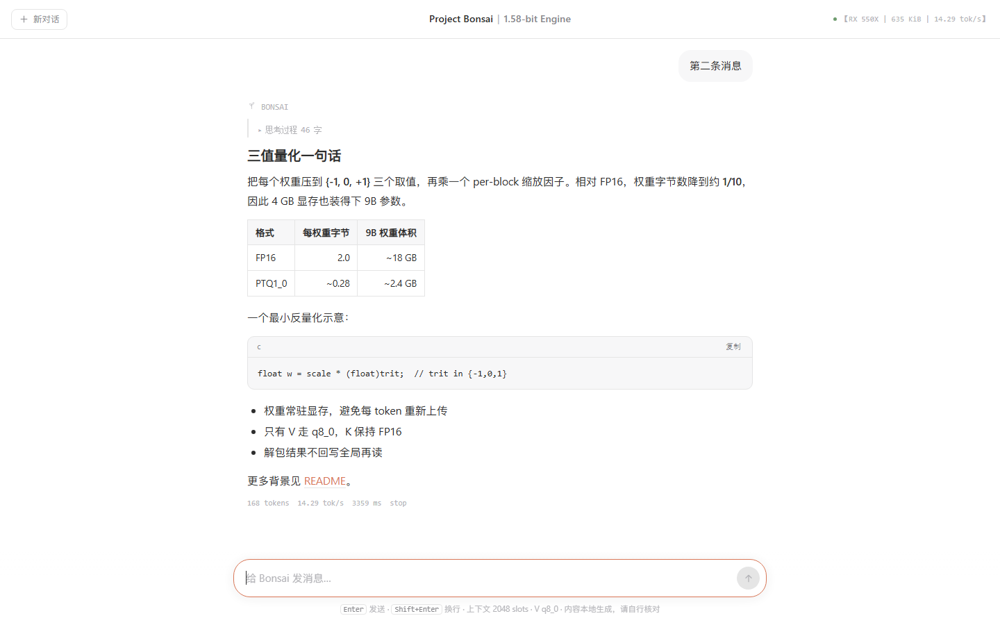

> **本项目的推理实现以忠实复现参考行为为目标**：分词器、注意力、KV 布局、反量化路径均与参考实现逐层对比，
> 确保专用 kernel 的加速不以输出质量为代价。速度优化在正确性验证通过后才计入 benchmark。
> 任何"跑得快但数字变了"的改动，在这里不是优化，是第二个模型。

# Project Bonsai（三值专用推理运行时）

**464 KiB 纯手搓 C++17 + 裸 Vulkan 推理引擎（`tools/source_size.py` 实测：去注释 464 KiB / 原样 765 KiB /
再去空白 313 KiB），只为 1.58-bit 三值模型而生。** 无框架、无 kernel 库、无 SDK、无管理员权限、无任何
第三方依赖，在 **4 GB 的 AMD RX 550X**（2017 年笔记本矿卡）上跑 **9B 三值模型 14.16 tok/s**
（`runs/regression_v14.log` 实测，纯 CLI 引擎速率），是同一张卡上参考引擎（4.417 t/s）的 **3.21 倍**。

```
$ cd runtime_vk && set BONSAI_QCHECK=1
$ bonsai_vk.exe run models/Ternary-Bonsai-2-9B-PTQ1_0.gguf 32 48
  rotation route: block_size = 4096 -> hat4096.comp (bit-frozen, the 9B's path), normalize = 0.015625
  prefill 1154.5 ms for 16 prompt tokens (13.86 tok/s)
=== QK kernel audit (BONSAI_QCHECK, 16 live keys in the row, cap 256, dispatching NARROW q2048) ===
  A  layer 0 (cap<=256): SCORE 0/4096 bit-diff, PROB 0, P16 0  -> bitwise identical
  A3 layer 0 (cap 256, ref NARROW, HPK 4, merged q512, grid 16 -> 4): SCORE 0/4096 bit-diff -> identical
  A4 layer 7 (cap 256, PV q8_0 frozen vs merged, grid 16 -> 4): PGATE 0/4096 bit-diff -> identical
  gate: PASS (bitmask 0 = A ok A2 ok A3 ok A4 ok B ok C ok D ok E ok)
  48 generated tokens in 3389.5 ms  ->  14.16 tok/s
  first generated token (prefill+1): 70.2 ms; steady-state: 70.6 ms/token
```

## 快速上手 — WebUI

双击 `bonsai_vk.exe`（或跑 `bonsai_vk.exe serve`）。引擎装载权重后在 **8080** 端口起一个只绑 loopback
的 HTTP 服务，并自动打开默认浏览器到 `http://localhost:8080`。零安装、零 Node、零构建——整个前端就是
随 exe 附带的一个自包含 `index.html`。



- **对话**：在底部输入框打字；`Enter` 发送、`Shift+Enter` 换行。回复经 SSE 流式打字机呈现并渲染
  Markdown（标题、表格、代码、列表）。右上角徽标报告**实测**的设备、引擎体积与解码速率，不是写死的口号。
- **思考**：模型的 reasoning 阶段折叠在"思考过程"下，随后才是可见答案。设 `BONSAI_THINKING=0` 可直接流式输出答案。
- **OpenAI 兼容 API**：`POST /v1/chat/completions` 支持 `stream:true`（SSE）/ `false`（一次性），另有
  `GET /v1/models`、`GET /v1/status`、`GET /health`。同一时刻只服务一个对话，第二个并发请求收 `429`。
  服务只绑 loopback 并拒绝非 loopback 的 `Host` 头。

```
curl http://localhost:8080/v1/chat/completions -H "Content-Type: application/json" ^
  -d "{\"model\":\"bonsai\",\"stream\":true,\"messages\":[{\"role\":\"user\",\"content\":\"你好\"}]}"
```

CLI 路径不变：`bonsai_vk.exe run <gguf> 32 48` 仍打印与上面相同的 gate 与速率。HTTP 外壳不增加任何
每 token 的 GPU 工作——它只把 forward 已经产出的 token 序列化出去。

**Linux**：同一份源码可用 `runtime_vk/build_linux.sh` 在 Linux 编译（POSIX sockets + amdgpu sysfs 显存
监控，替代 Winsock + PDH/DXGI）。**Linux 编译支持已就绪，待实机验证**——`#ifdef` 分支已写好、Windows
构建 0 warning，但没有 Linux 机器实跑。

## 为什么"只做三值"不是自我设限，而是全部优势的来源

- **格式即算法。** PTQ1_0 每字节塞 **5 个 trit**，每 **128 个权重共享一个 fp16 scale**。反量化就是 5 次
  `bitfieldExtract` 加一张 ±1/0 符号表——它能塞进寄存器，所以被**内联进 GEMV**，而不是一趟独立的全局内存
  读写。与官方反量化 kernel **在同一张卡上跑出的结果**对比：真实 128 000 权重 `max|err| = 0.00000`；
  合成 491 520 权重（含 `d=0`、次正规、负 scale、±Inf、±NaN）**逐位相同**。
- **不做通用性。** 没有 model-agnostic 计算图，没有算子注册表，没有张量库。引擎就是这一族 checkpoint 的
  形状：32 block = 24 层门控循环状态 + 8 层 softmax 注意力，hidden 4096，FFN 12288，vocab 248 320，
  `head_dim = 256`。
- **Hadamard 旋转是硬约束，不是可选项。** checkpoint 自带 `prism.hadamard.*` 元数据，自己声明了变换契约
  （`normalized-sylvester-walsh-hadamard`、block 4096、4096/12288 两套 sign、201 个被旋转的权重张量、
  `token_embd.weight` 存的是**逆基**）。引擎读这些键并按参考图给的顺序施加变换。漏掉它输出就是乱码——
  这是三值移植最容易翻车的第一件事。
- **每一句性能话都对应一条日志。** 见 [`BENCHMARK.md`](BENCHMARK.md)；长上下文那部分见
  [`KV_P0P1P2_MEASURED.md`](KV_P0P1P2_MEASURED.md)，里面还包含我们**自己测出来并公开纠正的两条错误前提**。

## 在 4 GB 电子垃圾上实测到的东西

| 本机实测 | |
|---|---|
| 解码速率 — **纯 CLI 极限吞吐**（引擎速率，无 HTTP） | **14.16–14.29 tok/s**（70.0–70.7 ms/token，48 token 一趟）：`runs/regression_v14.log`、`runs/webui_regression_v3.log`、`runs/webui_attrib_v2.log` 腿 A = 14.22 |
| 解码速率 — **HTTP Serve 引擎自报**（`/v1/status.last_tok_s`，不含 prefill + 网络） | **14.03–14.23 tok/s**：`runs/webui_ab_v1_summary.txt` = 14.03、`runs/webui_attrib_v2.log` 腿 C = 14.23 |
| 端到端 — **客户端墙钟**（含 prefill + loopback HTTP） | **≈ 9.1–9.8 tok/s**，`runs/webui_attrib_v2.log` 腿 C 客户端 = 9.49 —— 这是体验值，**不是**引擎解码率 |
| 同 checkpoint 同卡的参考引擎 | 4.417 t/s ⇒ 首次点火 13.99 tok/s 时 **3.16×**，今日 14.16 tok/s 时 **3.21×** |
| 三值 GEMV `M=12288 K=4096` | **176.9 Gop/s**，打包权重侧 44.2 GB/s（12 次连编自检的带宽 173.6–177.0 Gop/s，`runs/build_v31.log` … `build_v42.log`） |
| 全模型加权 kernel 组合 | **147.3 Gop/s** |
| 权重装载 | 冷 **14.05–14.44 s**（四次互相独立的首读）/ 热 **1.05–1.20 s**；夹具不控制页缓存状态，所以两个口径都列 |
| device-local 占用 | 已提交权重 **2467.7 MiB**（2.410 GiB）；活动区 cap 256 **58.2 MiB**、cap 2048 **101.339 MiB**、cap 32768 **841.261 MiB**（三档都由引擎自己打印；256 那档 = 52.0 MiB 与 cap 无关部分 + 256 × 24.66 KiB）；PDH dedicated：cap 256 **2539.23 MiB**（= 2467.7 + 58.2 + **13.3 MiB** 驱动收走但预算表没建模的部分）、32 K **3323.84 MiB**；两档的 `Shared Usage` 增长都是 **+0.00** |
| 长上下文（配对复测，默认合并 QK 开） | 4 K **9.41** / 8 K **6.93** / 16 K **4.57** / 32 K **2.67 tok/s**（`runs/gqa_pair_v1_summary.txt`；同一二进制、同一热窗口的关闭对照是 7.88 / 5.34 / 3.29 / 1.84） |
| KV 代价 | 8 层注意力合计 **24.50 KiB/token**（V 走 q8_0、K 保持 fp16）。arena 算术给出的 4 GB 上限 ≈ **39.2 K token**——为什么它和参考引擎的 `-c 49152` 墙不是一个数，见下表下方的说明 |
| gfx803 无 DP4A、无矩阵核心，且 `shaderFloat16 = 0` | 所以每个 MAC 都是标量 fp32 对内联解出的三值操作数；fp16 用 `f16_rne.glslh` 手工实现 |

上面三行速率是**三次不同的测量，绝不混在一起取平均**。纯 CLI 极限与 serve 引擎自报都按"生成 token 数 ÷
forward 墙钟"计（不含 prefill 与网络），所以二者一致在 ≈ 14.2 tok/s；客户端墙钟还要额外付 prefill 与
loopback 往返，所以落在 9.5 附近。[`PROJECT_BONSAI_WEBUI_REPORT.md`](PROJECT_BONSAI_WEBUI_REPORT.md) §4
是同一套口径。把其中一个当成另一个来引用，正是这张表要防止的错误。

本仓库里流传着两个"4 GB 墙"的数字，它们**不是同一次测量**，所以故意分开列：`-c 49152` 通过、`53248`
失败是**参考 llama.cpp fork** 在这个 checkpoint 上的预算（`END_TO_END_MEASURED.md`，实测）；而 ≈ 39.2 K
token 是**我们** arena 的算术上限（**推导**，全部常数取自引擎自己打印的那一行：已提交权重 2467.7 MiB、
与 cap 无关的活动区 52.0 MiB、每槽 24.66 KiB、DXGI LOCAL 预算 3464.6 MiB ⇒
`(3464.6 − 2467.7 − 52.0) × 1024 ÷ 24.66 = 39 237` 槽；若按原始 3840 MiB device-local heap 算是 54 825 槽，
而引擎在 cap 256 自己就把这个余量印出来了：`headroom 1314.1 MiB (= 54558 more slots)`，
`runs/gqa_gate_c256_v1.log:49`）。这张表原先写的 38.3 K 是 MiB→KiB 误用 ×1000 造成的偏低 2.5 %，
2026-11-05 已更正；"40 K 出带、48 K 超 239 MiB"两个结论不受影响（它们本来就是 ×1024 口径算的）。
两者都没有在真实运行里被推到 32 K 以上。

**源码体量：去注释 464 KiB**（原样 765 KiB——注释记的是"为什么"而不是"是什么"；连空白一起去掉是
313 KiB；其中 C++ 主机侧 400 KiB、GLSL 64 KiB），编译产物是 **635.7 KiB 单文件 exe（650 996 B）+ 52 支
SPIR-V（300 KiB）**。以上每个数字都只由 `python tools/source_size.py` 生产，别的地方不手抄。WebUI 之前
的引擎是去注释 416 KiB / 539 KiB 二进制；HTTP 服务、跨平台 `bonsai_platform.h` 抽象与 WebUI 服务路径是
增量来源。Windows 链接参数 `-lvulkan-1 -lpdh -ldxgi -lws2_32 -lshell32`，全是操作系统自己给的（Linux 只
需 `-lvulkan -lpthread`）。测量驱动（`align_*.cpp`、`bonsai_fleet.cpp`、`gpu_fleet.h`）另有去注释 310 KiB，
跑模型不需要它们。

## 验证状态（当前）

| 层 | 对齐对象 | 结果 | 出处 |
| --- | --- | --- | --- |
| 1. Tokenizer 逐 ID | 官方 PrismML `llama-tokenize.exe` | 39/39 探针完全 1:1（含中文、英、日、韩、混排、数字、空白、换行） | [FAITHFUL_REPRO.md](FAITHFUL_REPRO.md) §1 |
| 2. PTQ1_0 反量化 | 官方 `dequant_ptq1_0.comp` 在本卡跑出的结果 | 真实 1000 块 / 128 000 权重 `max\|err\| = 0.00000`；合成 3840 块 / 491 520 权重逐位 | [FAITHFUL_REPRO.md](FAITHFUL_REPRO.md) §2 |
| 3. 注意力 | 官方 `kq`/`kq_soft_max`/rope dump + fp32 镜像 | 层 3 全链路 `max\|err\|` = 6.7e-04 / 2.9e-03 / 3.6e-03（seq 8/32/64），**小于官方 fp16 缓存格式自身的舍入代价**（比值 0.141/0.262） | [FAITHFUL_REPRO.md](FAITHFUL_REPRO.md) §3、[ATTENTION_ALIGN_FINAL.md](ATTENTION_ALIGN_FINAL.md) |
| 4. KV 布局 | 自有 position-major fp16 arena | prefill 一把灌 vs 逐 token 灌：**0 位差异**；死槽严格 +0.0 | [FAITHFUL_REPRO.md](FAITHFUL_REPRO.md) §4 |
| 5. 行内核四谱系 | `BONSAI_QCHECK=1` 位相同门 | narrow ≡ wide ≡ tiled ≡ **GQA 合并**，逐位 0 差；差 1 bit 就 **rc 6 拒绝生成** | [KV_P0P1P2_MEASURED.md](KV_P0P1P2_MEASURED.md) §9–§10 |
| 6. 采样 | 官方 sampler | **待做**（明确后置） | — |

## 两条注意力路径，以及为什么两个都留在二进制里

长上下文靠"一个 workgroup 服务 HPK = 4 个 query 头"来消 GQA 冗余：K 的 gather 事务数砍 4×，同时常驻
workgroup 也从 16 掉到 4——在 12 CU 的卡上这两件事互相打架，所以开关必须存在。

| 开关 | 含义 |
|---|---|
| `BONSAI_GQA_OPT=1`（默认 auto） | 几何判定划算时由合并内核接管行。**用途 = 长上下文吞吐**：与自己的对照在同一热窗口配对复测（`runs/gqa_pair_v1_summary.txt`）——4 K 126.9 → **106.3 ms/token**（延迟 −16.2 %，7.88 → **9.41 tok/s**，+19.4 %）、8 K 187.4 → 144.3（−23.0 %，5.34 → 6.93）、16 K 303.6 → 218.6（−28.0 %，3.29 → 4.57）、32 K 542.5 → 374.8（**−31.0 %**，1.84 → **2.67**，+45.1 %）。短上下文白送：cap 256 默认测得 **14.16 tok/s**（70.6 ms/token），对照冻结基线 14.05–14.20，即 0 % 回归。 |
| `BONSAI_GQA_OPT=0` | narrow / wide / tiled 行内核 + 冻结 `attn_pv_q8v`，即**整条保真阶梯测过的那套位精确路径**，不重编就能复现。 |
| `BONSAI_GQA_PART` | `1` 只合并 QK（默认）、`2` 只合并 PV、`3` 两半。它是**归因仪器**不是配置，收益并不是一个符号：在合并 QK 之上再加 PV 合并，长上下文是**亏**的（4 K 106.3 → 118.1 ms，32 K 374.8 → 470.4 ms），而 cap 256 是**赚**的（72.7 → 70.9 ms）。所以 bit 1 默认关闭，依据是测量不是口味。更早的非配对轮（batch G）保留在 `BENCHMARK.md`，作为归因仪器而不是头条。 |
| `BONSAI_QKERNEL` / `BONSAI_QK_TILE` / `BONSAI_GQA_TILE` | 强制指定行内核与 tile 宽，让四条谱系能在同一份输入上对比计时。 |

**取舍一句话：优化路径提升长上下文速度，精确路径用于验证——而它们产出的不是两个答案。**
`BONSAI_QCHECK=1` 会把合并内核和它替换的内核，在**同一份 KV 字节**上各跑一遍，逐位比较 SCORE / PROB /
打包后的 fp16 行，覆盖首末两个注意力层的全部 16 头 × cap 槽位；只要有一位不同就 `rc 6` 拒绝生成。
cap 256 处合并 ≡ narrow，1 310 个活 key 跨六个 tile 时合并 ≡ wide，512 个点积的双精度 oracle 复算依旧报
`0.000e+00`。位相同 = 性能实验；位不同 = 第二个模型。

## 27B：不买卡的两条路

5.9 GB 的三值 27B 装不进 4 GB，而且永远装不进——所以这两条机制的意义是"不需要装进"。两条都已在本机
**建出来并实测**，不是计划。

1. **多卡流水线**（`bonsai_fleet.exe split <layers> <cards> [budget_MiB] --model PATH`）：按层把区间分给
   每张设备（三种策略，每种各有一句诚实的理由：layer / KV 加权均衡 / 等分；前两种在设备数 < 2 时拒绝），
   hidden state 通过**锁页内存环形缓冲** + **传输专用队列族**上的异步 DMA 跨卡传递，让第 *k+1* 卡的块与
   第 *k* 卡的拷贝重叠。本机真正测到的东西（`runs/fleet_ring_v4.log`，命令 `bonsai_fleet.exe ring 4 8 6`
   = 深度 4、槽 8 MiB、6 hop）：

   | | |
   |---|---|
   | 环的正确性 | D2H 落地 **0 字节不符**（读 12 word / 写 4 槽），游标交叉校验 `produced 6 vs hops 6 -> consistent` |
   | 单条 8 MiB D2H（传输专用族） | **1204.6 µs = 6.96 GB/s = 实测 7.15 GB/s 上限的 97 %**，含 submit + fence + 队列排空 |
   | 8 条 8 MiB 塞进**一次** submit | **每份 1176.4 µs = 7.13 GB/s** 端到端——同步被摊薄后引擎能做到的批处理 |
   | 背压 | 深度 4 出现 **2 次**；深度 1 每 hop 吃一次主机等待，所以"深度"是机制而不是调参旋钮 |
   | 每 hop（本机一张卡扮演两张） | wall **3171.3 µs**，D2H fence 2706.7 µs，门铃 0.3 µs，命令缓冲回收 17.8 µs / 8 次等待 |
   | 本机的多卡拓扑 | `probe` 报 **1 COMPUTE-capable device of 1 physical device**，所以（A）层流水线多卡在本机 **NOT AVAILABLE / 无法演练**：调度、环、fence 都在本机能走到的路径上编译并测过，但没有跨过任何一次 PCIe-to-PCIe 的 hop |

   最后一行就是诚实边界：环、DMA 腿、背压、门铃、带宽是实测；第二张卡的计算流和卡间通道不是，因为这
   台笔记本只有一张可用 GPU。让这套设计仍然值得建的两个数字是更早、独立的：**SDMA 7.12 GB/s 且与计算
   并发不打折**、单卡每 token 主机侧气泡 **16.8 ms**（fence 11.8 + submit 5.0）——见 `DEEPINFER_EVAL.md`
   与 `END_TO_END_MEASURED.md`。代码：`runtime_vk/gpu_fleet.h`；工具：`bonsai_fleet.exe selftest|probe|split|ring`。
2. **核显零拷贝**：选中的设备若是 `VK_PHYSICAL_DEVICE_TYPE_INTEGRATED_GPU`，权重 arena 直接落到**同时**
   `HOST_VISIBLE | DEVICE_LOCAL` 的堆上，staging buffer 与每批 H2D 拷贝整条消失，CPU 一次性把权重写进
   GPU 已在读的内存。没有 WDDM 预算、没有 spill、没有 4 GB 墙——核显本来就没有独立显存池可耗尽。
   `bonsai_fleet.exe probe` 在本机把这条**能力**报成 AVAILABLE：内存类型 2 和 6 确实同时是
   `DEVICE_LOCAL | HOST_VISIBLE | HOST_COHERENT`——但在这张独显上那块堆是一个 **256 MiB 的 BAR 窗口**，
   放不下 2.34 GiB 的权重 arena，这正是零拷贝分支只在 `deviceType == INTEGRATED_GPU` 上开启、本机永不
   走进的原因。分支不触发时独显路径一字节未变，所以全部历史实测数据依然成立。

27B 的混合层（64 层里只有 16 层全注意力、48 层循环状态）沿用的是 9B 已经在强制的同一条结构不变量：
**循环状态层不许分到一个 KV cache slot**，这是不变量不是约定，而 `align_27b.exe` 证明了它：16 个计费层
合计 **49.000 KiB/token**、cap 32 768 时 arena **1568.00 MiB**、循环状态 **100.50 MiB**，而被禁止的"每层
都挂 KV"分配器定价是 **196.000 KiB/token = 4.0×**（cap 32 768 时 4704 MiB）。同一个工具还守住旋转契约
（`prism.hadamard.version` 决定要不要旋转；`block_size` 在 9B 的位冻结 `hat4096.comp` 与通用
`hadamard_fwht.comp` 之间路由，后者在 block 16/64/256/1024/4096 上**与主机 Sylvester FWHT 逐位相同**），
以及四个必须拒绝、也确实拒绝了的负控。本机跑不动真实的 5.9 GB checkpoint：被证明的是 resolver、计费
不变量和内核路由，用的是一张由 9B 真实 header 搭出来的合成 64-block 形状。见
`runtime_vk/bonsai_model.h`（plan 与计费）和 `runtime_vk/align_27b.cpp`（闸门）。

## 两条吃掉真实工时数的驱动教训

完整记录在 [`HANDOVER.md`](HANDOVER.md)；放进 README 是因为它们在任何 Vulkan 移植里都足以吃掉一整天。

**`VkBufferCreateInfo::pQueueFamilyIndices` 在 `vkCreateBuffer` 期间被读取，但不被拷贝到任何地方。**
把队列族数组声明在设置 sharing mode 的那个 `if` 里，驱动就指着一个已经死掉的栈帧。它在 `-O0` 下侥幸
活着，在 `-O2` 下于 `amdvlk64.dll` 内部 SIGSEGV，回溯看起来完全像驱动的 Bug。四处调用点被上提，其中
一处在引擎自己的 staging-buffer 路径（`bonsai_weights.h::stage_alloc`）。如果优化级别能改变正确性，
嫌疑人不是优化器，是对象生命周期。

**用 `VK_FENCE_CREATE_SIGNALED_BIT` 创建的 fence，在等待执行时已经是 signaled 状态**，于是
`vkWaitForFences` 直接返回，跟本该 arm 它的那次 submit 毫无关系。这是规范行为不是驱动 Bug，但在写出
对照实验之前，它在本项目里制造了两个错误结论：一个物理上不可能的 56.67 GB/s"批处理"速率，和一个看起来
被同步支配、其实是 DMA 支配的 hop。同一份 8 MiB 拷贝、同一队列，并排实测：created-SIGNALED = fence
0.8 µs，后面跟着 1195.2 µs 的队列排空；`flags = 0` = fence 1204.1 µs，尾巴 0.4 µs。本仓库每一支 fence
都以 `flags = 0` 创建、只由自己的 submit arm；环形缓冲额外用一个门铃 word 发布完成——它和载荷写在**同一
支命令缓冲**里，靠队列序保证，不依赖任何 fence 语义假设。

## 复现

```bat
cd /d runtime_vk   :: SPIR-V 按「当前目录/shaders」加载，见下方硬规矩
build_mingw.bat                       :: 编 52 支 SPIR-V + 引擎 + 全部 align_*/probe 工具
bonsai_vk.exe run <gguf> 32 48        :: 端到端；set BONSAI_QCHECK=1 会先跑位相同门
align_tokenizer.exe <gguf> ..\runs\tok_probes.txt ..\runs\tok_ref_32.jsonl
align_f16.exe
align_dequant.exe <gguf> 1000
align_dequant.exe <gguf> synth
align_attn.exe 64 256
align_27b.exe <gguf>                 :: 27B 闸门：PTQ1_0 解码、64-block 路由、SSM 计费 = 0、旋转版本/块宽路由
align_27b.exe <gguf> --no-gpu        :: 同样的闸门，跳过上卡的那条 FWHT 腿
bonsai_fleet.exe selftest            :: 55 项主机侧检查（不读盘上的 SPIR-V，在任何目录都能跑）
bonsai_fleet.exe probe               :: 拓扑判定，不创建 logical device
bonsai_fleet.exe ring 4 8 6          :: 锁页环：深度 4、槽 8 MiB、6 hop
bonsai_fleet.exe split 32 2          :: 2 卡的层区间切分（1 卡时拒绝）
batch_g.sh v1 & batch_h.sh v1        :: GQA 首轮 / 配对复测
cd .. && python tools\source_size.py :: README 与 BENCHMARK 里每一个字节数的唯一来源
```

**为什么必须先 `cd`**：引擎按**当前工作目录**下的 `shaders\*.spv` 加载着色器，不是按 exe 所在目录。这条
是实测：在仓库根目录敲 `runtime_vk\bonsai_vk.exe …` 会打印
`cannot open shaders/repack_ptq1_0.spv - compile shaders first` 然后停下（加载器把失败报了而不是崩，
所以它是一条规矩而不是一个谜）。`align_tokenizer.exe` 是唯一不加载着色器的工具，也因此是唯一能在仓库根
目录用根相对路径跑的那条命令；在 `runtime_vk\` 里跑它要写 `..\runs\…`。发行包里 `shaders\` 和 exe 同级，
所以在包根目录跑就是同一条规矩。

**拿到手先验货**。在 `dist\bonsai-vk-0.1.0-win64\` 里跑 `sha256sum -c MANIFEST.sha256` ⇒ **118/118 OK**，
而且这条声明是**能穿过 `git clone`** 的：`.gitattributes` 把整棵树钉成 `-text`，入不加规范化、出不做
行尾转换。之所以要专门钉它——这台机器是 `core.autocrlf=true`，一个 LF 文件在 checkout 之后的字节和清单
记录的字节不是一回事（一次性空仓库实测：同一个文件 blob 哈希 `e49c81e2…`、落地文件哈希 `98ab4d3a…`）。
所以验收的做法是**把 index 导出到一个空目录再去核对**，而不是在原地自证清白。

纪律（全是踩坑换来的，已写进代码）：同一时刻只允许一个 GPU 进程；每次计时前先 `tools/clear_field.ps1`；
结果一律落 `runs/<名字>_v<N>.log`，不覆盖旧日志；不能用批处理脚本复跑的基准测试等于没发生过。

## 文档索引

- [README.md](README.md) — 英文旗舰版
- [PROJECT_BONSAI_FULL_DOSSIER.md](PROJECT_BONSAI_FULL_DOSSIER.md) — **《终极全景档案》**：四大底层手术带完整算术、跨硬件与多卡布局、中英双语宣发文案，以及**因没测过而被禁止说出口的四句话**
- [PROJECT_BONSAI_FINAL_REPORT.md](PROJECT_BONSAI_FINAL_REPORT.md) — **《Project Bonsai 终极完工报告》**：全部产物与精确字节数、四项任务逐条记账（实测 / 推导 / 未验证）、未闭合事项清单
- [PROJECT_BONSAI_WEBUI_REPORT.md](PROJECT_BONSAI_WEBUI_REPORT.md) — **《WebUI + 跨平台外壳交付报告》**：验证矩阵、体积增量、serve 速率归因、Linux"就绪待实机"边界
- [BENCHMARK.md](BENCHMARK.md) — 全部实测数字与其日志出处
- [HANDOVER.md](HANDOVER.md) — **交接文档（先读这份）**：状态、环境、代码地图、全部实测事实、踩坑纪律、产物索引
- [FAITHFUL_REPRO.md](FAITHFUL_REPRO.md) — 忠实复现五层对齐验证的实测记录与复现命令
- [ATTENTION_ALIGN_FINAL.md](ATTENTION_ALIGN_FINAL.md) — 层 3 注意力对齐最终战报：最大误差、合成块结论、五条真因
- [KV_P0P1P2_MEASURED.md](KV_P0P1P2_MEASURED.md) — KV 闸门：驱逐门、q8_0 V、spill 判据、tiling、GQA 合并（§10），以及被实测否掉的两条长上下文前提
- [runtime_vk/gpu_fleet.h](runtime_vk/gpu_fleet.h) — 多卡锁页环 + 核显零拷贝机制，注释里带着塑造它的实测；配套工具是 `bonsai_fleet.cpp`
- [STAGE0_REPORT.md](STAGE0_REPORT.md) — 硬件摸底：ISA 约束、带宽、可用 Vulkan 扩展
- [STAGE1_KERNEL.md](STAGE1_KERNEL.md) / [STAGE2_CUSTOM.md](STAGE2_CUSTOM.md) — WGSL 探针数值 / 自有 PTQ1_0 GEMV
- [STAGE3_RUNTIME.md](STAGE3_RUNTIME.md) — MinGW 工具链、原生 Vulkan 运行时跑通、正确性真因（漏 `vkCmdPipelineBarrier`）
- [DEEPINFER_EVAL.md](DEEPINFER_EVAL.md) — DeepInfer 四项机制在本卡评估
- [END_TO_END_MEASURED.md](END_TO_END_MEASURED.md) — 参考引擎端到端实测（4.417 t/s）与 4 GB 显存墙
- [ROADMAP.md](ROADMAP.md) — 剩余工作，按实测收益排序

## 许可 / 来源

运行时采用 **Apache-2.0** 许可 —— 全文见 [`LICENSE`](LICENSE)（版权行 `2026 The Project Bonsai
Authors`）。选 Apache-2.0 而非 MIT，是因为它的显式专利授权对推理运行时很重要。

checkpoint 格式、Hadamard 元数据以及作为 oracle 的参考 dump 来自公开发布的 Ternary-Bonsai；运行时是本
仓库原创，不含任何推理框架的代码。模型权重不包含在本仓库中，沿用其自身的发布条款。随包的
`dequant_ptq1_0_ref.spv` 是官方 PrismML 参考内核，仅用作保真 oracle，从不进入引擎前向路径。
